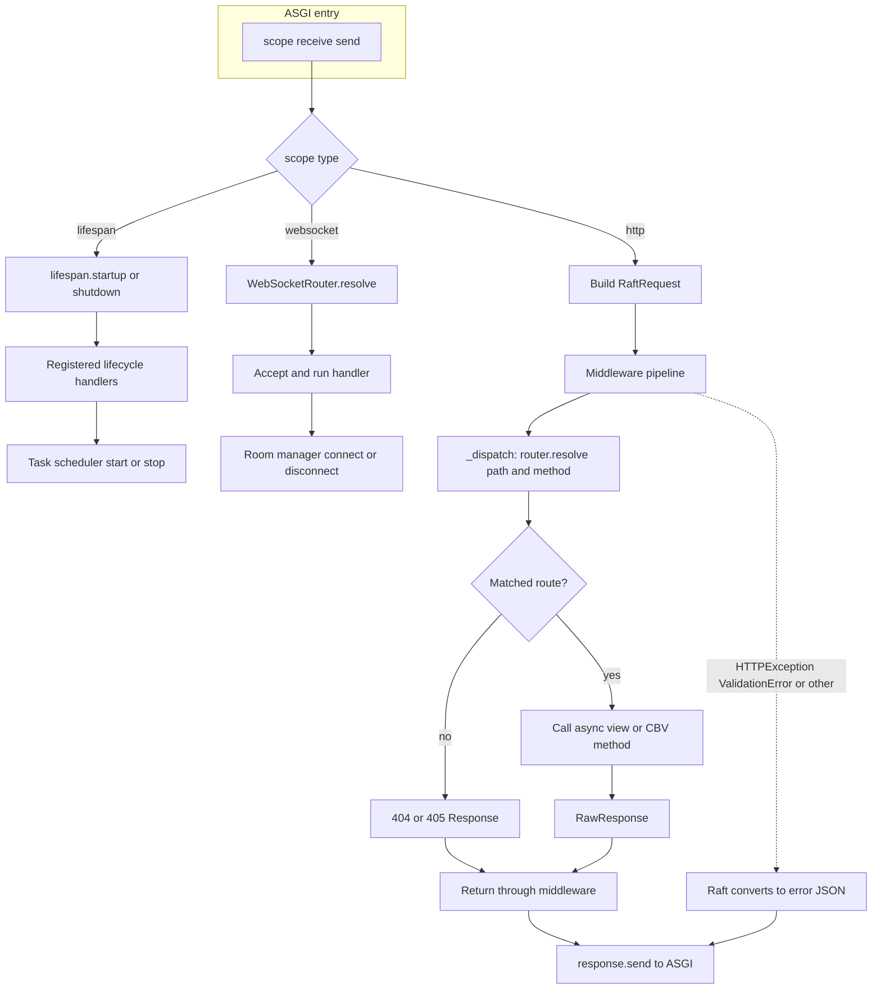
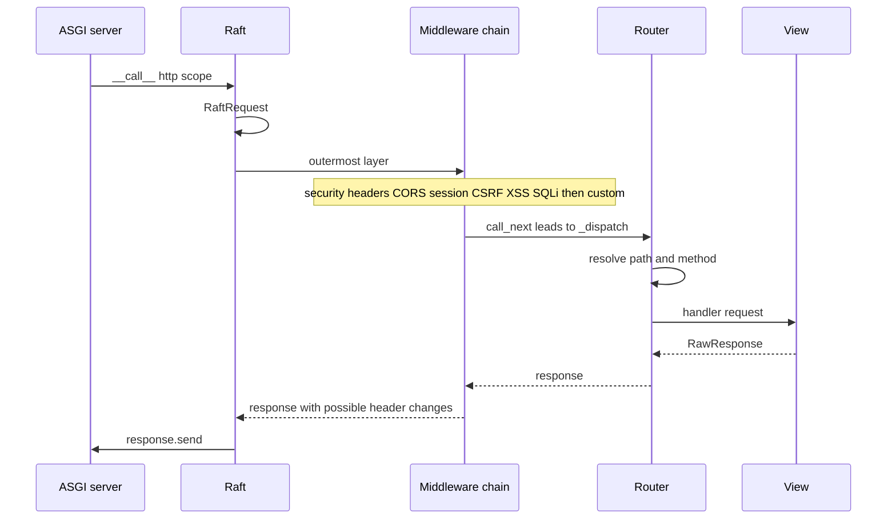

# Raft Framework

**A Python web framework with hybrid routing, built on ASGI.**

Raft is a **production-ready when configured correctly** Python web framework that combines a structured, batteries-included developer experience with modern async Python and a hybrid routing system that supports both decorator and URL-conf styles.

> See **[DEPLOYMENT.md](DEPLOYMENT.md)** for workers, Redis, secrets, OpenAPI, HSTS, and rate limiting.
>
> **Full documentation site:** open **[docs/index.html](docs/index.html)** in your browser (HTML/CSS/JS — no build step).

---

## 1. Project Vision Summary

Raft Framework aims to be a **beginner-friendly, production-aware** Python web framework with:

- **Structured DX** — familiar project layout, class-based views, URL-conf routing
- **Modern Python** — async/await everywhere, type hints, Pydantic v2
- **ASGI-native** — built for uvicorn, supports async middleware pipelines
- **Hybrid routing** — use decorators (Flask-style) or centralized URL lists (URL-conf), or mix both
- **Batteries included** — sessions (memory or Redis), JWT auth, security headers, CORS, CSRF, OpenAPI, task scheduling, WebSocket routes
- **CLI scaffolding** — `raft init` creates projects interactively
- **UV-compatible** — works seamlessly with the `uv` package manager

---

## 2. Scalable Folder Structure

```
raft-framework/
├── pyproject.toml              # Package metadata, dependencies, CLI entry point
├── .env.example                # Example environment configuration
├── .gitignore
├── LICENSE
├── README.md                   # This file
│
├── raft/                       # Framework source code
│   ├── __init__.py             # Public API re-exports
│   │
│   ├── core/                   # Core abstractions
│   │   ├── __init__.py
│   │   ├── app.py              # Raft ASGI application class
│   │   ├── request.py          # RaftRequest wrapper
│   │   ├── response.py         # Response + RawResponse
│   │   ├── router.py           # Router, Route, route()/include(), discovery
│   │   ├── type_enforcement.py # Dual-runtime type engine (HTTP coercion + Mypy analyzer)
│   │   ├── views.py            # Class-based view (CBV) base
│   │   └── exceptions.py       # HTTPException hierarchy
│   │
│   ├── middleware/              # Middleware pipeline + built-in middleware
│   │   ├── __init__.py
│   │   ├── base.py             # MiddlewarePipeline, types
│   │   ├── cors.py             # CORS middleware
│   │   ├── csrf.py             # CSRF protection
│   │   ├── xss.py              # XSS scanning
│   │   └── sqli.py             # SQL injection scanning
│   │
│   ├── security/               # Security utilities
│   │   ├── __init__.py
│   │   └── headers.py          # Security response headers
│   │
│   ├── session/                # Session management
│   │   ├── __init__.py
│   │   ├── backend.py          # Session middleware + memory/redis store selection
│   │   └── redis_store.py      # Redis-backed session store
│   │
│   ├── redis/                  # Optional Redis client helpers
│   │   ├── __init__.py
│   │   └── client.py
│   │
│   ├── auth/                   # JWT access tokens + @require_auth
│   │   ├── __init__.py
│   │   └── jwt.py
│   │
│   ├── openapi/                # OpenAPI schema + Swagger/ReDoc
│   │   ├── __init__.py
│   │   ├── router.py
│   │   ├── schema.py
│   │   └── ui.py
│   │
│   ├── config/                 # Configuration
│   │   ├── __init__.py
│   │   └── settings.py         # RaftSettings (python-decouple)
│   │
│   ├── server/                 # Server runners
│   │   ├── __init__.py
│   │   └── dev.py              # Dev (hot-reload) + prod server
│   │
│   ├── cli/                    # CLI tool
│   │   ├── __init__.py
│   │   ├── main.py             # Click commands (init, runserver, check, version)
│   │   ├── ui.py               # Figlet banner + Rich panels/tables
│   │   ├── scaffold.py         # Project scaffolding templates
│   │   └── project_checks.py   # ``raft check`` internals
│   │
│   ├── tasks/                  # Background scheduler
│   │   ├── __init__.py
│   │   └── scheduler.py
│   │
│   ├── websocket/              # WebSocket routing + room manager
│   │   ├── __init__.py
│   │   ├── connection.py
│   │   ├── manager.py
│   │   └── router.py
│   │
│   └── utils/                  # Shared utilities (future)
│       └── __init__.py
│
└── examples/                   # Sample apps (not part of the installed package)
    ├── app.py                  # Broad feature tour
    └── todo_demo/              # REST + OpenAPI (see its README)

tests/                          # Unit tests
```

---

## 3. Folder-by-Folder Explanation

| Folder | Purpose |
|---|---|
| `raft/core/` | The heart of the framework: ASGI app, request/response wrappers, routing engine, views, and exceptions. Everything here is imported by user code. |
| `raft/middleware/` | Middleware pipeline infrastructure and built-in security middleware (CORS, CSRF, XSS, SQLi). |
| `middleware/` (project app folder) | Your custom middleware modules. Raft auto-detects async callables ending in `_middleware` (or a `MIDDLEWARE = [...]` export) at startup. |
| `raft/security/` | Security-specific utilities — currently security response headers. Future: rate limiting. |
| `raft/session/` | Server-side sessions with signed cookie transport; backends `memory` (default) or `redis`. |
| `raft/redis/` | Built-in Redis client; configure with `RAFT_REDIS_URL` or leave unused (`get_redis`, `redis_key`). |
| `raft/auth/` | JWT helpers (`create_access_token`, `@require_auth`) and optional `jwt_auth_middleware`. |
| `raft/openapi/` | OpenAPI schema generation, Swagger UI, and ReDoc. |
| `raft/config/` | Centralized settings via `python-decouple`. Reads `.env` files and provides typed access. |
| `raft/server/` | Server runners for development (hot-reload via uvicorn `--reload`) and production. |
| `raft/cli/` | Click + Rich + pyfiglet CLI: `raft init`, `runserver`, `check`, `version`. |
| `raft/utils/` | Reserved for shared helper functions (encoding, logging formatters, etc.). |
| `examples/` | Optional sample projects; install the `raft-framework` package from the repo root to run them. |

---

## 4. Core Architecture Explanation

### ASGI Application (`Raft`)
The `Raft` class implements the ASGI 3.0 interface (`__call__(scope, receive, send)`). It orchestrates:
1. **Middleware Pipeline** — a chain of async callables that wrap the final dispatcher
2. **Router** — matches URL paths to view handlers using compiled regex
3. **Exception Handler** — catches `HTTPException` and Pydantic `ValidationError`, converting them to structured JSON

### Request/Response
- `RaftRequest` wraps the raw ASGI scope and receive callable into a clean, typed API
- `RawResponse` is a low-level ASGI response sender
- `Response` is a factory that produces `RawResponse` objects with the unified JSON envelope

### JSON envelope (`Response`)
Successful responses include `status`, `message`, and `data` only. The `errors` key is **omitted** when there are no errors. On failure (`status: false`), `errors` is a list of non-empty strings (field paths and messages) when present; it is still omitted if there is nothing meaningful to report.

### Middleware Pipeline
Middleware functions follow a simple signature: `async def mw(request, call_next) -> response`. They form a chain — each middleware calls `call_next` to invoke the next layer, and can modify the request before or the response after.

### Routing
Routes support `{param}` syntax for path parameters (compiled to named regex groups). Preferred registration styles:
- **Method decorators** — `@app.get`, `@app.post`, `@app.put`, `@app.patch`, `@app.delete` (same on `Router`)
- **Django-style route table** — `route()` / `include()` / `routes` via `app.add_routes(...)`
- Router nesting via `include_router`, plus low-level `@route(methods=[...])` for multi-method handlers

### Starter welcome page
When `DEBUG` is on and **no HTTP routes** are registered yet, Raft serves a branded HTML starter page for any unmatched path (instead of a JSON 404). As soon as you define a route (`@app.get`, `routes = [...]`, etc.), that page no longer appears.

### Circuit breaker (outbound resilience)
Protect calls to other services (monolith externals or microservice peers)::

```python
from raft import CircuitBreaker, CircuitOpenError, Response

payments = CircuitBreaker("payments", failure_threshold=5, recovery_timeout=30)

@payments
async def charge(amount: float):
    # outbound HTTP / RPC
    ...

@app.get("/checkout")
async def checkout(request):
    try:
        await charge(9.99)
    except CircuitOpenError:
        return Response.custom(
            status=False, message="Payments unavailable", http_status=503
        )
    return Response.success(message="charged")
```

Shared named breakers: `get_circuit("payments")`.

### Autodiscovery (`Raft` startup)
`Raft()` discovers hybrid HTTP routes **anywhere under the project root** (not only `routes/`): modules that export a **`routes`** table (`route()` / `include()`) or a **`router` / `ROUTERS`**. Tests, venvs, and the framework package itself are skipped. Set `RAFT_ROUTES_SCAN=dir` to limit discovery to `RAFT_ROUTES_DIR` (default `routes`). Toggle with `RAFT_AUTO_DISCOVER_ROUTES` / `Raft(auto_discover_routes=False)`.

```python
# api/users.py  (any folder — auto-loaded)
from raft import route, Response

async def list_users(request):
    return Response.success(data=[])

routes = [
    route("/users/", list_users, methods=["GET"]),
]

# app.py
from raft import Raft
app = Raft()  # discovers api/users.py — no add_routes()
```

### How Raft handles a request (overview)

At runtime the ASGI server calls `Raft.__call__`. **HTTP** traffic goes through the middleware pipeline, then the router, then your view; **WebSocket** and **lifespan** messages branch to their own handlers. Exceptions raised while running the HTTP chain are converted to a JSON `Response` before `send`.



For a single HTTP round trip, the same path is easier to read as a sequence:



---

## 5. Type System Explanation

Raft features **Dual-Runtime Type Enforcement ("Raft TypeShield")**, combining **Static Code Type Analysis via Mypy** and **Runtime HTTP Parameter Validation & Coercion**.

### A. Dual-Runtime Pillars

1. **Runtime HTTP Parameter Enforcement (`raft.core.type_enforcement`)**:
   - **Annotated Parameters (Strict)**: Automatically coerces incoming path variables, query string parameters, and JSON body keys to target Python types (`int`, `float`, `bool`, `str`, `bytes`, `uuid.UUID`, `datetime`, `date`, `time`, Pydantic `BaseModel`). Invalid types or missing required values automatically return **HTTP 422 Unprocessable Entity**.
   - **Unannotated Parameters (Lax)**: Received raw without triggering type conversion or 422 errors.
   - **Request Injection**: `request: RaftRequest` is automatically injected into handler functions.

2. **Static Mypy Analysis (`raft check` / `app.typecheck_routes()`)**:
   - Uses `mypy.api.run` to analyze registered route source files and project code on demand or at startup.

### B. Parameter Resolution Order
When a view handler declares a parameter `x: int`, Raft resolves it in this order:
1. **Path Variable** (from URL template `/items/{x}`)
2. **Query String** (from `?x=42`)
3. **JSON / Form Body** (from `{"x": 42}`)

### Key Types

| Type | Where Used | What It Means |
|---|---|---|
| `RaftRequest` | View function first argument | Wraps ASGI scope; provides `.method`, `.path`, `.headers`, `.cookies`, `.query_params`, `.path_params`, `.session`, `.body()`, `.json()`, `.form()`, `.files()` |
| `RawResponse` | Return type of all views | Low-level response with `.body`, `.status_code`, `.headers`, `.set_cookie()`, `.send()` |
| `Response` | Static factory class | Class methods like `.success()`, `.error()`, `.created()`, `.bad_request()` return `RawResponse` instances with the unified JSON envelope; subclass for custom envelopes |
| `ViewCallable` | `Callable[[RaftRequest], Awaitable[RawResponse]]` | Type alias for async view functions |
| `CallNext` | `Callable[[RaftRequest], Awaitable[RawResponse]]` | Middleware's "next handler" callback |
| `MiddlewareFunc` | `Callable[[RaftRequest, CallNext], Awaitable[RawResponse]]` | Signature every middleware must follow |
| `Route` | Dataclass | Holds path pattern, handler, methods, name |
| `Router` | Class | Collects routes, resolves paths, supports nesting |
| `View` | Base class for CBVs | Override `get()`, `post()`, etc.; register via `View.as_view()` |
| `UploadedFile` | Property of parsed multipart | `.filename`, `.content_type`, `.body`, `.size`, `.save(path)` |
| `BaseModel` subclasses | OpenAPI / typing / body validation | Pass to route or view parameters for automatic JSON body validation |

### What Users Pass vs. Get Back

| Function | User Passes | User Gets |
|---|---|---|
| `@app.route("/path")` | Path string, method list | Decorator that registers the function |
| View function | `request: RaftRequest, id: int` | `RawResponse` (with `id` coerced to `int`) |
| `request.json()` | — (awaited) | Parsed Python dict/list |
| `request.files()` | — (awaited) | `dict[str, UploadedFile]` |
| `Response.success(data={...})` | Message string + data dict | `RawResponse` with `{"status": true, "message": "...", "data": {...}}` (no `errors` key on success) |
| `app.typecheck_routes()` | — | `(stdout, stderr, exit_status)` from Mypy analysis |


---

## 6. Example Usage

### Simple REST Route (FBV)
```python
from raft import Raft, Response

app = Raft()

@app.get("/hello")
async def hello(request):
    return Response.success(message="Hello, World!")

@app.post("/hello")
async def hello_post(request):
    return Response.created(message="Created")
```

### Path Parameters
```python
@app.get("/users/{user_id}")
async def get_user(request):
    user_id = request.path_params["user_id"]
    return Response.success(data={"id": user_id})
```

### Class-Based View (CBV)
```python
from raft.core.views import View
from raft.core.router import Route

class ItemView(View):
    async def get(self, request):
        return Response.success(data={"item": "Widget"})

    async def post(self, request):
        body = await request.json()
        return Response.created(data=body)

app.add_route(Route("/items", ItemView))
```

`Route` accepts a `View` subclass directly; it calls `as_view()` internally.

```python
# Equivalent explicit registration:
app.add_route(Route("/items", ItemView.as_view()))
```

### Reading Query Params, Headers, Cookies
```python
@app.route("/info", methods=["GET"])
async def info(request):
    return Response.success(data={
        "q": request.get_query_param("q"),
        "accept": request.get_header("accept"),
        "session_cookie": request.get_cookie("raft_session"),
        "ip": request.client_ip,
        "browser": request.user_agent,
    })
```

### File Upload
```python
@app.route("/upload", methods=["POST"])
async def upload(request):
    files = await request.files()
    for name, f in files.items():
        f.save(f"/tmp/{f.filename}")
    return Response.success(message=f"{len(files)} file(s) saved")
```

### Session Read/Write
```python
@app.route("/session/set", methods=["POST"])
async def set_session(request):
    body = await request.json()
    request.session["username"] = body["username"]
    return Response.success(message="Session updated")

@app.route("/session/get", methods=["GET"])
async def get_session(request):
    username = request.session.get("username", "anonymous")
    return Response.success(data={"username": username})
```

Parse JSON yourself (`await request.json()`), validate with **Serializers**, or use Pydantic models with OpenAPI `request_body=` / `responses=`.

### Serializers (input/output validation)
Django-style serializers without the `Raft` prefix:

```python
from raft import Serializer, StrField, IntField, EmailField, validate_body, Response

class UserIn(Serializer):
    username = StrField(min_length=1, max_length=50)
    age = IntField(min_value=0, required=False, default=18)

    def validate_username(self, value: str) -> str:
        return value.lower()

class UserOut(Serializer):
    id = IntField(read_only=True)
    username = StrField(read_only=True)

@app.post("/users/", request_serializer=UserIn, response_serializer=UserOut)
async def create_user(request):
    payload = await validate_body(request, UserIn)
    user = {"id": 1, **payload.validated_data}
    return Response.success(data=UserOut.serialize(user))
```

Helpers: `validate_body`, `validate_query`, `validate_form`. Field hooks: `validate_<field>` and `validate()`. Stack Click options on project commands, not serializers.

Read/write flags: `read_only=True` (output only), `write_only=True` (input only).

### Custom Middleware
```python
from raft.middleware.base import CallNext

async def timing_middleware(request, call_next: CallNext):
    import time
    start = time.monotonic()
    response = await call_next(request)
    response.headers["X-Response-Time"] = f"{time.monotonic() - start:.4f}s"
    return response

app.add_middleware(timing_middleware)
```

Auto-discovery option (clean project structure):
1. Create a top-level `middleware/` folder in your app project.
2. Add a module like `middleware/request_id.py`.
3. Define async middleware functions ending with `_middleware`.
4. Start your app normally. Raft logs `New middleware detected: ...` and auto-registers them.

Example `middleware/request_id.py`:
```python
async def request_id_middleware(request, call_next):
    import secrets

    request_id = secrets.token_hex(8)
    response = await call_next(request)
    response.headers["X-Request-ID"] = request_id
    return response
```

### Centralized route table (Django-style)
```python
from raft import route, include

routes = [
    route("/users/", list_users, methods=["GET"], name="user-list"),
    route("/users/{id}/", get_user, methods=["GET"], name="user-detail"),
    route("/users/", create_user, methods=["POST"], name="user-create"),
    route("/api/", include([
        route("/items/", list_items, methods=["GET"]),
    ])),
]
app.add_routes(routes)
```

Or keep a `Router` with method decorators and mount it:

```python
from raft import Router

api = Router(prefix="/api/v1")

@api.get("/users")
async def list_users(request): ...

app.include_router(api)
```

### Swagger UI / API Docs
```python
from raft.openapi import OpenAPIRouter

openapi = OpenAPIRouter(
    app,
    title="My API",
    version="1.0.0",
    description="Interactive API documentation",
)
app.include_router(openapi.router)
```

Endpoints: `/openapi.json`, `/docs` (Swagger UI), `/redoc`.

**Protect with HTTP Basic** (static username + password):
```env
RAFT_OPENAPI_DOCS_ENABLED=true
RAFT_OPENAPI_DOCS_USERNAME=docs
RAFT_OPENAPI_DOCS_PASSWORD=my-docs-password
```

**Disable in production** (returns 404 for all three endpoints):
```env
RAFT_OPENAPI_DOCS_ENABLED=false
# or: RAFT_OPENAPI_DOCS_VISIBILITY=disabled
```

`private` visibility also requires credentials (defaults username to `admin` if unset). Doc HTML uses a relaxed CSP so Swagger/ReDoc CDN assets load correctly.

### Task Scheduler (Celery-like Easy Usage)
```python
from raft import Raft
from raft.tasks import periodic_task

app = Raft()

@periodic_task(every=30, repeat=True, run_immediately=True)
async def refresh_cache_task():
    print("refreshing cache")

def cleanup_temp_files():
    print("cleanup temp files")

app.add_task(cleanup_temp_files, every=300, name="cleanup")
```

Recommended structure:
1. Put periodic jobs in a project-level `tasks/` folder.
2. Mark jobs with `@periodic_task(...)` for auto-discovery.
3. Keep plain helper functions there too, and import them in views when needed.

Example view import usage:
```python
from tasks.periodic import build_welcome_message

@app.route("/welcome/{name}", methods=["GET"])
async def welcome(request):
    name = request.path_params["name"]
    return Response.success(data={"message": build_welcome_message(name)})
```

Set `repeat=False` to run only once.

The scheduler starts automatically on ASGI lifespan startup and stops on shutdown.

Important: this scheduler is in-process. If you run multiple workers, each worker runs the tasks.

### WebSocket (Easy Room Chat Style)
```python
from raft import Raft

app = Raft()

@app.websocket("/ws/chat/{room}")
async def room_chat(ws):
    room = ws.path_params["room"]
    await ws.join_room(room)
    await ws.send_json({"event": "joined", "room": room})

    while True:
        try:
            text = await ws.receive_text()
        except ConnectionError:
            break
        await ws.send_room(room, text)
```

This is intentionally lightweight: no separate consumer classes or channel layers required for basic usage.

---

## 7. CLI

Figlet banner + Rich panels (Click commands).

### `raft` / `raft version`
Shows the RAFT ASCII banner and version.

### `raft init`
```bash
$ raft init myproject
# Interactive prompts → feature summary table → scaffold
```

Every new project includes `app.py`, empty `routes/`, `views/`, and `commands/` (with a sample `hello.py`). **`raft init` does not create a `schemas/` or `serializers/` folder**. Optional dirs: `tasks/`, `ws/`, `middleware/`, `models/` (+ `setraft.py`). Generated `.env` gets a random `RAFT_SECRET_KEY`.

### `raft run`
Django-style project scripts from a `commands/` folder (configurable via `RAFT_COMMANDS_DIR`):

```python
# commands/seed.py
from raft.commands import command

@command(help="Seed demo data")
def seed():
    print("Seeding...")
```

```bash
$ raft run              # list commands
$ raft run seed         # run seed
$ raft run hello        # sample from raft init
```

Stack Click options **below** `@command`:

```python
import click
from raft.commands import command

@command(help="Rebuild cache")
@click.option("--force", is_flag=True)
def rebuild_cache(force: bool):
    ...
```

Async commands are supported (`async def`).

### `raft runserver`
```bash
# Development (hot reload)
$ raft runserver --reload

# Custom host/port
$ raft runserver --host 0.0.0.0 --port 3000

# Production (no reload, multiple workers)
$ raft runserver --no-reload --workers 4

# Custom app path
$ raft runserver --app myapp.main:app
```

### `raft check`
Runs **inside the CLI** (no generated `raft_check.py`). From your project root it verifies layout, `app`/`main` import, `RAFT_SECRET_KEY`, core dependencies, optional **PostgreSQL** reachability when `setraft.py` uses PostgreSQL, **raftsql** import when the ORM is configured, **WebSocket** / **scheduler** starter modules when those folders exist, a **Raft route summary** (HTTP + WebSocket route counts), and finally **`python -m pytest -q --tb=line`** (skipped with a hint if `pytest` is not installed; use **`raft check --no-tests`** to skip the test run).

```bash
$ raft check
```

---

## 8. Configuration

### `.env` File (python-decouple)
Create a `.env` in your project root:
```env
RAFT_DEBUG=true
RAFT_SECRET_KEY=my-super-secret-random-key-at-least-32-bytes
RAFT_HOST=127.0.0.1
RAFT_PORT=8000
RAFT_ALLOWED_HOSTS=*
RAFT_CORS_ALLOWED_ORIGINS=http://localhost:3000,https://myapp.com
RAFT_LOG_LEVEL=info
RAFT_OPENAPI_DOCS_ENABLED=true
RAFT_OPENAPI_DOCS_VISIBILITY=public
# RAFT_OPENAPI_DOCS_USERNAME=docs
# RAFT_OPENAPI_DOCS_PASSWORD=

# Sessions + Redis (optional)
RAFT_SESSION_BACKEND=memory
# RAFT_SESSION_BACKEND=redis
# RAFT_REDIS_URL=redis://localhost:6379/0
# RAFT_REDIS_PREFIX=raft:

# JWT (PyJWT is a core dependency)
# RAFT_JWT_SECRET=  # defaults to RAFT_SECRET_KEY when empty
RAFT_JWT_ALGORITHM=HS256
RAFT_JWT_EXPIRE_MINUTES=60
```

Access in code:
```python
from raft.config.settings import settings

print(settings.DEBUG)           # bool
print(settings.SECRET_KEY)      # str
print(settings.ALLOWED_HOSTS)   # list[str]
print(settings.SESSION_BACKEND) # "memory" | "redis"
```

### Redis (built-in, config-only)

The ``redis`` package is included with Raft. Leave config empty to ignore it; set a URL when you want a client or Redis sessions:

```env
RAFT_REDIS_URL=redis://localhost:6379/0
RAFT_REDIS_PREFIX=raft:
RAFT_SESSION_BACKEND=redis
```

```python
from raft import get_redis, redis_configured

if redis_configured():
    get_redis().ping()
```

### JWT authentication

**Method decorators** (``@app.get`` / ``@app.post`` / ``@router.get``):

```python
@app.get(
    "/me",
    authentication_classes=[JWTAuthentication],
    permission_classes=[IsAuthenticated],
)
async def me(request):
    return Response.success(data={"user": request.user})

@app.post("/login")
async def login(request):
    token = create_access_token({"sub": "user-1", "role": "admin"})
    return Response.success(data={"access_token": token, "token_type": "bearer"})
```

**Class-based views** — preferred with `route()` tables:

```python
from raft import View, route, Response, create_access_token
from raft.auth import JWTAuthentication, IsAuthenticated

class MeView(View):
    authentication_classes = [JWTAuthentication]
    permission_classes = [IsAuthenticated]

    async def get(self, request):
        return Response.success(data={"user": request.user})

routes = [
    route("/login/", login, methods=["POST"]),
    route("/me/", MeView, methods=["GET"]),
    # Or protect an FBV from the table:
    # route("/me/", me, methods=["GET"],
    #       authentication_classes=[JWTAuthentication],
    #       permission_classes=[IsAuthenticated]),
]
```

**Function views** — same classes via decorators:

```python
from raft.auth import authentication_classes, permission_classes, JWTAuthentication, IsAuthenticated

@authentication_classes([JWTAuthentication])
@permission_classes([IsAuthenticated])
async def me(request):
    return Response.success(data={"user": request.user})

routes = [route("/me/", me, methods=["GET"])]
```

**Shortcut** for simple FBVs: `@require_auth()`. Optional app-wide claim attachment: `app.add_middleware(jwt_auth_middleware)` (does not reject missing tokens).

Send `Authorization: Bearer <token>`. Claims land on `request.user`; raw token on `request.auth`.

### Development Mode
```bash
# .env
RAFT_DEBUG=true

# Run with hot-reload
raft runserver --reload
```

### Production Mode
```bash
# .env
RAFT_DEBUG=false
RAFT_SECRET_KEY=<random-64-char-string>
RAFT_ALLOWED_HOSTS=myapp.com,www.myapp.com
RAFT_CORS_ALLOWED_ORIGINS=https://myapp.com

# Run via uvicorn directly
uvicorn app:app --host 0.0.0.0 --port 8000 --workers 4
```

---

## 9. Using `uv`

### Project Setup
```bash
# Create a new project
uv init myraft
cd myraft

# Add raft-framework as a dependency
uv add raft-framework

# Or for development from source
uv add --editable ../raft-framework

# Install all dependencies
uv sync
```

### Running
```bash
# Run the dev server
uv run raft runserver

# Run directly with uvicorn
uv run uvicorn app:app --reload

# Run the CLI
uv run raft init myproject
uv run raft check

# Run tests
uv run pytest
```

### Lock File
```bash
# Generate/update lock file
uv lock

# Sync from lock file (CI/CD)
uv sync --locked
```

---

## 10. Security Notes

### Protections Included

| Protection | Status | Notes |
|---|---|---|
| **Security Headers** | ✅ Included | X-Frame-Options, X-Content-Type-Options, Referrer-Policy, Permissions-Policy, CSP, HSTS (prod) |
| **CORS** | ✅ Included | Configurable origins, methods, headers; preflight handling |
| **CSRF** | ✅ Included | Synchronizer token pattern via session + header/form field |
| **Multipart uploads** | ✅ Included | Parsed with `python-multipart` via `request.form()` / `request.files()` |
| **Rate limiting** | ✅ Opt-in | Middleware + Redis backend; use reverse proxy at scale (see DEPLOYMENT.md) |
| **XSS Scanning** | ⚠️ Heuristic | Pattern scan only — use output encoding + CSP in production |
| **SQLi Scanning** | ⚠️ Heuristic | Regex hints only — use parameterised queries / ORM |
| **Session Security** | ✅ Included | Signed cookies, HttpOnly, SameSite; Secure when not DEBUG; memory TTL or Redis |
| **JWT Auth** | ✅ Included | HS256 access tokens + `@require_auth`; set a long `RAFT_JWT_SECRET` / `RAFT_SECRET_KEY` |

### Production hardening notes

Raft ships production-capable sessions, JWT, security headers (including **HSTS when `DEBUG=false`**), OpenAPI doc controls, serializers, hardened multipart parsing, and optional rate limiting. You still must configure secrets, Redis for multi-worker sessions, and disable or protect docs — see **[DEPLOYMENT.md](DEPLOYMENT.md)**.

1. **XSS / SQLi middleware** — Heuristic only. Primary defences: output encoding, parameterised SQL, strict CSP.

2. **Session store** — Use `RAFT_SESSION_BACKEND=redis` with multiple workers.

3. **CSRF** — Enable for HTML forms; consider double-submit cookies for high-risk apps.

4. **CSP** — Tailor `Content-Security-Policy` for your asset domains.

5. **Secret key** — Replace `change-me-in-production` with a cryptographically random string (≥32 bytes).

6. **Rate limiting** — Enable `RAFT_RATE_LIMIT_ENABLED=true` or configure nginx/Cloudflare limits (recommended at scale).

7. **Authentication** — JWT access tokens included; add refresh/OAuth as your product requires.

---

## 11. Future Roadmap

| Feature | Priority | Description |
|---|---|---|
| **RaftSQL ORM** | High | Deeper first-party integration with the RaftSQL package (migrations UX, model registry) |
| **WebSocket refinements** | Medium | ASGI WebSockets and room helpers exist; channel layers, auth hooks |
| **OpenAPI refinements** | Medium | Deeper response models, auth schemes in Swagger |
| **Task Queue** | Medium | Celery integration with `raft task` CLI commands |
| **Static Files** | Medium | Serve static files in development |
| **Auth refinements** | Medium | Refresh tokens, OAuth2, user model helpers |
| **Testing Utilities** | Medium | `RaftTestClient` for easy async testing |
| **Signals / Events** | Low | Event-style hooks for app lifecycle |
| **Admin Panel** | Low | Auto-generated admin interface |
| **Caching** | Low | Response caching middleware + cache API |
| **i18n** | Low | Internationalization support |

---

## Quick Start

```bash
# 1. Install uv (if not already)
pip install uv

# 2. Create a project
uv init myapp && cd myapp
uv add raft-framework

# 3. Create app.py
cat > app.py << 'EOF'
from raft import Raft, Response

app = Raft()

@app.get("/")
async def index(request):
    return Response.success(message="Hello from Raft!")
EOF

# 4. Run
uv run uvicorn app:app --reload
```

Visit `http://127.0.0.1:8000` and see:
```json
{
    "status": true,
    "message": "Hello from Raft!",
    "data": null
}
```

---

**Raft Framework** — Simple. Typed. Async. Scalable.
