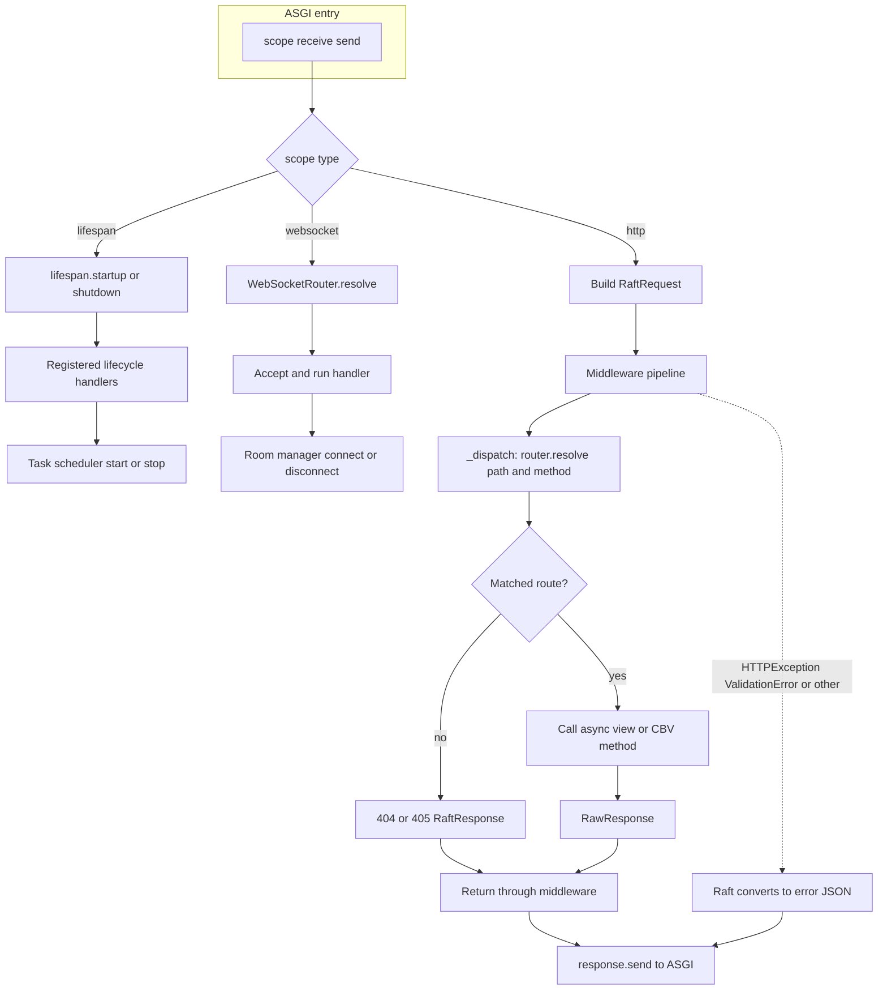
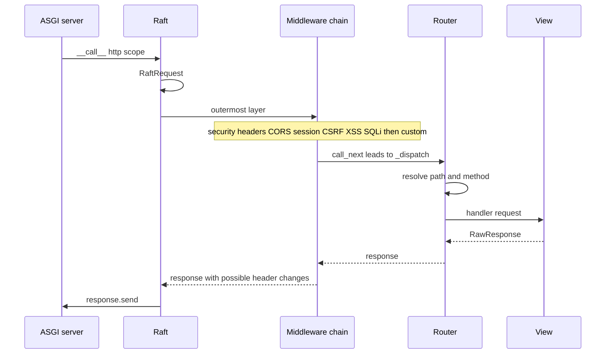

# Raft Framework

**A Django-like Python web framework with hybrid routing, built on ASGI.**

Raft is a prototype web framework that combines Django's developer experience with modern async Python, Pydantic validation, and a hybrid routing system that supports both decorator and URL-conf styles.

---

## 1. Project Vision Summary

Raft Framework aims to be a **beginner-friendly, production-aware** Python web framework with:

- **Django-like DX** — familiar project structure, CBVs, URL-conf routing
- **Modern Python** — async/await everywhere, type hints, Pydantic v2
- **ASGI-native** — built for uvicorn, supports async middleware pipelines
- **Hybrid routing** — use decorators (Flask-style) or URL lists (Django-style), or mix both
- **Batteries included** — sessions, security headers, CORS, CSRF, Pydantic validation, optional serializers + OpenAPI, optional GraphQL, task scheduling, WebSocket routes
- **CLI scaffolding** — `raft init` creates projects interactively
- **UV-compatible** — works seamlessly with the `uv` package manager

---

## 2. Scalable Folder Structure

```
raft-framework/
├── pyproject.toml              # Package metadata, dependencies, CLI entry point
├── .env.example                # Example environment configuration
├── .gitignore
├── LICENSE
├── README.md                   # This file
│
├── raft/                       # Framework source code
│   ├── __init__.py             # Public API re-exports
│   │
│   ├── core/                   # Core abstractions
│   │   ├── __init__.py
│   │   ├── app.py              # Raft ASGI application class
│   │   ├── request.py          # RaftRequest wrapper
│   │   ├── response.py         # RaftResponse + RawResponse
│   │   ├── router.py           # Router + Route + path compilation
│   │   ├── views.py            # Class-based view (CBV) base
│   │   └── exceptions.py       # HTTPException hierarchy
│   │
│   ├── middleware/              # Middleware pipeline + built-in middleware
│   │   ├── __init__.py
│   │   ├── base.py             # MiddlewarePipeline, types
│   │   ├── cors.py             # CORS middleware
│   │   ├── csrf.py             # CSRF protection
│   │   ├── xss.py              # XSS scanning
│   │   └── sqli.py             # SQL injection scanning
│   │
│   ├── security/               # Security utilities
│   │   ├── __init__.py
│   │   └── headers.py          # Security response headers
│   │
│   ├── session/                # Session management
│   │   ├── __init__.py
│   │   └── backend.py          # In-memory session store + middleware
│   │
│   ├── validation/             # Pydantic validation helpers
│   │   ├── __init__.py
│   │   └── validator.py        # validate_body, validate_query
│   │
│   ├── serialization/          # Serializer base + field helpers + registry
│   │   ├── __init__.py
│   │   ├── base.py             # Serializer, validation_error, hooks
│   │   ├── fields.py           # IntegerField, CharField, EmailField, BooleanField
│   │   └── registry.py         # register_serializer, autodiscovery merge → OpenAPI
│   │
│   ├── graphql/                # GraphQL integration
│   │   ├── __init__.py
│   │   └── integration.py      # GraphQLRouter (Strawberry)
│   │
│   ├── openapi/                # OpenAPI schema + Swagger/ReDoc
│   │   ├── __init__.py
│   │   ├── router.py
│   │   ├── schema.py
│   │   └── ui.py
│   │
│   ├── config/                 # Configuration
│   │   ├── __init__.py
│   │   └── settings.py         # RaftSettings (python-decouple)
│   │
│   ├── server/                 # Server runners
│   │   ├── __init__.py
│   │   └── dev.py              # Dev (hot-reload) + prod server
│   │
│   ├── cli/                    # CLI tool
│   │   ├── __init__.py
│   │   └── main.py             # Click commands (init, runserver, check)
│   │
│   ├── tasks/                  # Background scheduler
│   │   ├── __init__.py
│   │   └── scheduler.py
│   │
│   ├── websocket/              # WebSocket routing + room manager
│   │   ├── __init__.py
│   │   ├── connection.py
│   │   ├── manager.py
│   │   └── router.py
│   │
│   └── utils/                  # Shared utilities (future)
│       └── __init__.py
│
└── examples/                   # Sample apps (not part of the installed package)
    ├── app.py                  # Broad feature tour
    └── todo_demo/              # REST + serializers + OpenAPI (see its README)

tests/                          # Unit tests
```

---

## 3. Folder-by-Folder Explanation

| Folder | Purpose |
|---|---|
| `raft/core/` | The heart of the framework: ASGI app, request/response wrappers, routing engine, views, and exceptions. Everything here is imported by user code. |
| `raft/middleware/` | Middleware pipeline infrastructure and built-in security middleware (CORS, CSRF, XSS, SQLi). |
| `middleware/` (project app folder) | Your custom middleware modules. Raft auto-detects async callables ending in `_middleware` (or a `MIDDLEWARE = [...]` export) at startup. |
| `raft/security/` | Security-specific utilities — currently security response headers. Future: rate limiting, authentication helpers. |
| `raft/session/` | Server-side session management with signed cookie transport. Future: Redis/DB backends. |
| `raft/validation/` | Pydantic-powered request validation. `validate_body()` and `validate_query()` work with any `BaseModel`, including `Serializer`. |
| `raft/serialization/` | `Serializer` (Pydantic subclass) with field hooks (`validate_<field>`, `validate`), read/write field flags, `.data`, `serialize()` / `serialize_many()`, registry + autodiscovery for OpenAPI components. |
| `raft/graphql/` | Strawberry GraphQL integration. `GraphQLRouter` mounts a schema onto the Raft router. |
| `raft/config/` | Centralized settings via `python-decouple`. Reads `.env` files and provides typed access. |
| `raft/server/` | Server runners for development (hot-reload via uvicorn `--reload`) and production. |
| `raft/cli/` | Click-based CLI for project scaffolding (`raft init`), serving (`raft runserver`), and health checks (`raft check`). |
| `raft/utils/` | Reserved for shared helper functions (encoding, logging formatters, etc.). |
| `examples/` | Optional sample projects; install the `raft-framework` package from the repo root to run them. |

---

## 4. Core Architecture Explanation

### ASGI Application (`Raft`)
The `Raft` class implements the ASGI 3.0 interface (`__call__(scope, receive, send)`). It orchestrates:
1. **Middleware Pipeline** — a chain of async callables that wrap the final dispatcher
2. **Router** — matches URL paths to view handlers using compiled regex
3. **Exception Handler** — catches `HTTPException` and Pydantic `ValidationError`, converting them to structured JSON

### Request/Response
- `RaftRequest` wraps the raw ASGI scope and receive callable into a clean, typed API
- `RawResponse` is a low-level ASGI response sender
- `RaftResponse` is a factory that produces `RawResponse` objects with the unified JSON envelope

### JSON envelope (`RaftResponse`)
Successful responses include `status`, `message`, and `data` only. The `errors` key is **omitted** when there are no errors. On failure (`status: false`), `errors` is a list of non-empty strings (field paths and messages) when present; it is still omitted if there is nothing meaningful to report.

### Middleware Pipeline
Middleware functions follow a simple signature: `async def mw(request, call_next) -> response`. They form a chain — each middleware calls `call_next` to invoke the next layer, and can modify the request before or the response after.

### Routing
Routes support `{param}` syntax for path parameters (compiled to named regex groups). The router supports:
- Decorator registration (`@router.route(...)`)
- URL-conf registration (`router.add_routes([Route(...), ...])`)
- Router nesting (`router.include_router(sub_router)`)

### Autodiscovery (`Raft` startup)
Besides optional `middleware/` scanning, `Raft()` can load **`routes/`** modules that export `router` or `ROUTERS`, and register **`Serializer`** subclasses from **`serializers/`**. Toggle with `RAFT_AUTO_DISCOVER_ROUTES`, `RAFT_AUTO_DISCOVER_SERIALIZERS`, or the matching `Raft(..., auto_discover_routes=..., auto_discover_serializers=...)` arguments. Paths default to `BASE_DIR` from settings (typically the project root).

### How Raft handles a request (overview)

At runtime the ASGI server calls `Raft.__call__`. **HTTP** traffic goes through the middleware pipeline, then the router, then your view; **WebSocket** and **lifespan** messages branch to their own handlers. Exceptions raised while running the HTTP chain are converted to a JSON `RaftResponse` before `send`.



For a single HTTP round trip, the same path is easier to read as a sequence:



---

## 5. Type System Explanation

### Key Types

| Type | Where Used | What It Means |
|---|---|---|
| `RaftRequest` | View function first argument | Wraps ASGI scope; provides `.method`, `.path`, `.headers`, `.cookies`, `.query_params`, `.path_params`, `.session`, `.body()`, `.json()`, `.form()`, `.files()` |
| `RawResponse` | Return type of all views | Low-level response with `.body`, `.status_code`, `.headers`, `.set_cookie()`, `.send()` |
| `RaftResponse` | Static factory class | Class methods like `.ok()`, `.created()`, `.bad_request()` return `RawResponse` instances with the unified JSON envelope |
| `ViewCallable` | `Callable[[RaftRequest], Awaitable[RawResponse]]` | Type alias for async view functions |
| `CallNext` | `Callable[[RaftRequest], Awaitable[RawResponse]]` | Middleware's "next handler" callback |
| `MiddlewareFunc` | `Callable[[RaftRequest, CallNext], Awaitable[RawResponse]]` | Signature every middleware must follow |
| `Route` | Dataclass | Holds path pattern, handler, methods, name |
| `Router` | Class | Collects routes, resolves paths, supports nesting |
| `View` | Base class for CBVs | Override `get()`, `post()`, etc.; register via `View.as_view()` |
| `UploadedFile` | Property of parsed multipart | `.filename`, `.content_type`, `.body`, `.size`, `.save(path)` |
| `BaseModel` subclasses | Pydantic validation | Used with `validate_body(request, MyModel)` |
| `Serializer` | Request/response shaping + OpenAPI | Subclass of `BaseModel` with `IntegerField`, `CharField`, etc.; use `Serializer(data=...)` for input, `instance=...` for output, `.validated_data`, `.data`, `serialize()` / `serialize_many()` |

### What Users Pass vs. Get Back

| Function | User Passes | User Gets |
|---|---|---|
| `@app.route("/path")` | Path string, method list | Decorator that registers the function |
| View function | `request: RaftRequest` | `RawResponse` (via `RaftResponse.ok(...)` etc.) |
| `validate_body(request, Model)` | Request + Pydantic model class | Validated model instance (or raises `ValidationError`) |
| `request.json()` | — (awaited) | Parsed Python dict/list |
| `request.files()` | — (awaited) | `dict[str, UploadedFile]` |
| `RaftResponse.ok(data={...})` | Message string + data dict | `RawResponse` with `{"status": true, "message": "...", "data": {...}}` (no `errors` key on success) |

---

## 6. Example Usage

### Simple REST Route (FBV)
```python
from raft import Raft, RaftResponse

app = Raft()

@app.route("/hello", methods=["GET"])
async def hello(request):
    return RaftResponse.ok(message="Hello, World!")
```

### Path Parameters
```python
@app.route("/users/{user_id}", methods=["GET"])
async def get_user(request):
    user_id = request.path_params["user_id"]
    return RaftResponse.ok(data={"id": user_id})
```

### Class-Based View (CBV)
```python
from raft.core.views import View
from raft.core.router import Route

class ItemView(View):
    async def get(self, request):
        return RaftResponse.ok(data={"item": "Widget"})

    async def post(self, request):
        body = await request.json()
        return RaftResponse.created(data=body)

app.add_route(Route("/items", ItemView))
```

`Route` accepts a `View` subclass directly; it calls `as_view()` internally.

```python
# Equivalent explicit registration:
app.add_route(Route("/items", ItemView.as_view()))
```

### Reading Query Params, Headers, Cookies
```python
@app.route("/info", methods=["GET"])
async def info(request):
    return RaftResponse.ok(data={
        "q": request.get_query_param("q"),
        "accept": request.get_header("accept"),
        "session_cookie": request.get_cookie("raft_session"),
        "ip": request.client_ip,
        "browser": request.user_agent,
    })
```

### File Upload
```python
@app.route("/upload", methods=["POST"])
async def upload(request):
    files = await request.files()
    for name, f in files.items():
        f.save(f"/tmp/{f.filename}")
    return RaftResponse.ok(message=f"{len(files)} file(s) saved")
```

### Session Read/Write
```python
@app.route("/session/set", methods=["POST"])
async def set_session(request):
    body = await request.json()
    request.session["username"] = body["username"]
    return RaftResponse.ok(message="Session updated")

@app.route("/session/get", methods=["GET"])
async def get_session(request):
    username = request.session.get("username", "anonymous")
    return RaftResponse.ok(data={"username": username})
```

### Pydantic Validation
```python
from pydantic import BaseModel
from raft.validation.validator import validate_body

class CreateUser(BaseModel):
    name: str
    email: str
    age: int | None = None

@app.route("/users", methods=["POST"])
async def create_user(request):
    user = await validate_body(request, CreateUser)
    return RaftResponse.created(data=user.model_dump())
```

Invalid input automatically returns a JSON body with `status: false`, a message, and an `errors` list when there are field-level messages.

### Serializers (optional)

`Serializer` extends Pydantic with field helpers, read/write flags, and validation hooks. Use it with `validate_body` like any model, or wire it per route for OpenAPI request bodies.

```python
from raft import Serializer, validation_error
from raft.serialization import IntegerField, CharField

class TodoCreate(Serializer):
    title = CharField(max_length=200)
    priority = IntegerField(default=1, ge=1, le=5)

    def validate_title(self, value: str) -> str:
        value = value.strip()
        if not value:
            raise validation_error("title", "cannot be blank")
        return value

    def validate(self, attrs: dict) -> dict:
        return attrs
```

- **Input:** `TodoCreate(data=payload)` then `.model_validate()` (or `await validate_body(request, TodoCreate)`).
- **Output:** `TodoCreate(instance=obj).data` or `TodoCreate.serialize(obj)` / `TodoCreate.serialize_many(items)`.
- **OpenAPI:** call `register_serializer(TodoCreate)` or add a project `serializers/` package (enabled by default via `RAFT_AUTO_DISCOVER_SERIALIZERS` / `auto_discover_serializers` on `Raft`). On routes, pass `request_serializer=` / `response_serializer=` (aliases for `request_body` / default 200 response schema) so `/openapi.json` includes components.

Published OpenAPI schemas strip internal `raft_*` keys used for documentation metadata.

### GraphQL
```python
import strawberry
from raft.graphql.integration import GraphQLRouter

@strawberry.type
class Query:
    @strawberry.field
    def hello(self) -> str:
        return "Hello from GraphQL!"

schema = strawberry.Schema(Query)
gql = GraphQLRouter(schema, path="/graphql")
app.include_router(gql.router)
```

### Custom Middleware
```python
from raft.middleware.base import CallNext

async def timing_middleware(request, call_next: CallNext):
    import time
    start = time.monotonic()
    response = await call_next(request)
    response.headers["X-Response-Time"] = f"{time.monotonic() - start:.4f}s"
    return response

app.add_middleware(timing_middleware)
```

Auto-discovery option (clean project structure):
1. Create a top-level `middleware/` folder in your app project.
2. Add a module like `middleware/request_id.py`.
3. Define async middleware functions ending with `_middleware`.
4. Start your app normally. Raft logs `New middleware detected: ...` and auto-registers them.

Example `middleware/request_id.py`:
```python
async def request_id_middleware(request, call_next):
    import secrets

    request_id = secrets.token_hex(8)
    response = await call_next(request)
    response.headers["X-Request-ID"] = request_id
    return response
```

### Django-Style URL Patterns
```python
from raft import Router, Route

api = Router(prefix="/api/v1")
api.add_routes([
    Route("/users", list_users, methods=["GET"]),
    Route("/users/{id}", get_user, methods=["GET"]),
    Route("/users", create_user, methods=["POST"]),
])
app.include_router(api)
```

### Swagger UI / API Docs (Public or Private)
```python
from raft.openapi.router import OpenAPIRouter

openapi = OpenAPIRouter(
    app,
    title="My API",
    version="1.0.0",
    description="Interactive API documentation",
)
app.include_router(openapi.router)
```

Docs endpoints:
- `GET /openapi.json`
- `GET /docs` (Swagger UI)
- `GET /redoc` (ReDoc)

Swagger UI and ReDoc need third-party scripts; the HTML responses from `OpenAPIRouter` apply a **relaxed Content-Security-Policy** for those paths only, so they work together with the default strict `security_headers_middleware` elsewhere.

To protect docs with a password in `.env`:
```env
RAFT_OPENAPI_DOCS_VISIBILITY=private
RAFT_OPENAPI_DOCS_PASSWORD=my-docs-password
```

In `public` mode, no password is required:
```env
RAFT_OPENAPI_DOCS_VISIBILITY=public
```

### Task Scheduler (Celery-like Easy Usage)
```python
from raft import Raft
from raft.tasks import periodic_task

app = Raft()

@periodic_task(every=30, repeat=True, run_immediately=True)
async def refresh_cache_task():
    print("refreshing cache")

def cleanup_temp_files():
    print("cleanup temp files")

app.add_task(cleanup_temp_files, every=300, name="cleanup")
```

Recommended structure:
1. Put periodic jobs in a project-level `tasks/` folder.
2. Mark jobs with `@periodic_task(...)` for auto-discovery.
3. Keep plain helper functions there too, and import them in views when needed.

Example view import usage:
```python
from tasks.periodic import build_welcome_message

@app.route("/welcome/{name}", methods=["GET"])
async def welcome(request):
    name = request.path_params["name"]
    return RaftResponse.ok(data={"message": build_welcome_message(name)})
```

Set `repeat=False` to run only once.

The scheduler starts automatically on ASGI lifespan startup and stops on shutdown.

Important: this scheduler is in-process. If you run multiple workers, each worker runs the tasks.

### WebSocket (Easy Room Chat Style)
```python
from raft import Raft

app = Raft()

@app.websocket("/ws/chat/{room}")
async def room_chat(ws):
    room = ws.path_params["room"]
    await ws.join_room(room)
    await ws.send_json({"event": "joined", "room": room})

    while True:
        try:
            text = await ws.receive_text()
        except ConnectionError:
            break
        await ws.send_room(room, text)
```

This is intentionally simpler than Django Channels: no separate consumer classes or channel layers required for basic usage.

---

## 7. CLI Prototype

### `raft init`
```bash
$ raft init myproject

╭─────────────────────────────────────────╮
│ Raft Framework — New Project Setup      │
│ Project: myproject                       │
╰─────────────────────────────────────────╯
    Enable OpenAPI / Docs? [y/N]: n
    Use GraphQL? [y/N]: n
  Use ORM (RaftSql)? [y/N]: n
    Use built-in Task Scheduler (auto-detect tasks folder)? [y/N]: y
    Create custom middleware starter file? [y/N]: y
  Use WebSocket? [y/N]: n
    Use .env file? [y/N]: n

✔ Project myproject created at /path/to/myproject
  cd myproject
  uv sync              # install deps
  raft runserver       # start dev server
```

If `Use GraphQL?` is `No`, the scaffold stays REST-only (no `graphql_schema/` and no `strawberry-graphql` dependency).

### `raft runserver`
```bash
# Development (hot reload)
$ raft runserver --reload

# Custom host/port
$ raft runserver --host 0.0.0.0 --port 3000

# Production (no reload, multiple workers)
$ raft runserver --no-reload --workers 4

# Custom app path
$ raft runserver --app myapp.main:app
```

### `raft check`
```bash
$ raft check

╭────────────────────╮
│ Raft Config Checker │
╰────────────────────╯
  ✔ .env file
  ✔ App entry point (app.py)
  ✘ SECRET_KEY is set
      Set RAFT_SECRET_KEY in .env
  ✔ Core dependencies
  ✔ pyproject.toml

Some checks failed — see hints above.
```

---

## 8. Configuration

### `.env` File (python-decouple)
Create a `.env` in your project root:
```env
RAFT_DEBUG=true
RAFT_SECRET_KEY=my-super-secret-random-key
RAFT_HOST=127.0.0.1
RAFT_PORT=8000
RAFT_ALLOWED_HOSTS=*
RAFT_CORS_ALLOWED_ORIGINS=http://localhost:3000,https://myapp.com
RAFT_LOG_LEVEL=info
RAFT_OPENAPI_DOCS_VISIBILITY=public
RAFT_OPENAPI_DOCS_PASSWORD=
```

Access in code:
```python
from raft.config.settings import settings

print(settings.DEBUG)           # bool
print(settings.SECRET_KEY)      # str
print(settings.ALLOWED_HOSTS)   # list[str]
```

### Development Mode
```bash
# .env
RAFT_DEBUG=true

# Run with hot-reload
raft runserver --reload
```

### Production Mode
```bash
# .env
RAFT_DEBUG=false
RAFT_SECRET_KEY=<random-64-char-string>
RAFT_ALLOWED_HOSTS=myapp.com,www.myapp.com
RAFT_CORS_ALLOWED_ORIGINS=https://myapp.com

# Run via uvicorn directly
uvicorn app:app --host 0.0.0.0 --port 8000 --workers 4
```

---

## 9. Using `uv`

### Project Setup
```bash
# Create a new project
uv init myraft
cd myraft

# Add raft-framework as a dependency
uv add raft-framework

# Or for development from source
uv add --editable ../raft-framework

# Install all dependencies
uv sync
```

### Running
```bash
# Run the dev server
uv run raft runserver

# Run directly with uvicorn
uv run uvicorn app:app --reload

# Run the CLI
uv run raft init myproject
uv run raft check

# Run tests
uv run pytest
```

### Lock File
```bash
# Generate/update lock file
uv lock

# Sync from lock file (CI/CD)
uv sync --locked
```

---

## 10. Security Notes

### Protections Included

| Protection | Status | Notes |
|---|---|---|
| **Security Headers** | ✅ Included | X-Frame-Options, X-Content-Type-Options, Referrer-Policy, Permissions-Policy, CSP, HSTS (prod) |
| **CORS** | ✅ Included | Configurable origins, methods, headers; preflight handling |
| **CSRF** | ✅ Included | Synchronizer token pattern via session + header/form field |
| **XSS Scanning** | ⚠️ Prototype | Scans inputs for `<script>`, `javascript:`, `on*=` patterns. NOT a replacement for output encoding |
| **SQLi Scanning** | ⚠️ Prototype | Scans inputs for `UNION SELECT`, `DROP TABLE`, etc. NOT a replacement for parameterised queries |
| **Session Security** | ✅ Included | Signed cookies (itsdangerous), httponly, samesite=Lax |
| **Input Validation** | ✅ Included | Pydantic v2 validation with structured error responses |

### What is Prototype-Only (Needs Hardening for Production)

1. **XSS Middleware** — Pattern-based scanning is easily bypassed. Production apps MUST use output encoding at the template layer and a strict Content-Security-Policy.

2. **SQLi Middleware** — Heuristic regex patterns catch obvious attacks but sophisticated injection bypasses them. The primary defense MUST be parameterised queries / ORM usage.

3. **Multipart Parser** — The built-in parser handles simple cases. For production, integrate `python-multipart` for robust boundary handling and streaming.

4. **Session Store** — The in-memory store loses all sessions on restart and doesn't scale across processes. Use Redis or a database backend for production.

5. **CSRF** — The current implementation uses a simple session token. Production apps should add double-submit cookies, per-form tokens with expiry, and template auto-injection.

6. **CSP Header** — The default policy is strict (`default-src 'self'`). Tighten or extend it for your asset domains; if you add doc UIs outside `OpenAPIRouter`, you may need a similar per-route CSP override so inline or CDN scripts are allowed only where intended.

7. **Secret Key** — The default `change-me-in-production` must be replaced with a cryptographically random string.

8. **Rate Limiting** — Not included. Add a rate-limiting middleware or use a reverse proxy (nginx, Cloudflare).

9. **Authentication** — Not included. Implement JWT, OAuth2, or session-based auth as needed.

---

## 11. Future Roadmap

| Feature | Priority | Description |
|---|---|---|
| **RaftSQL ORM** | High | SQLAlchemy-based ORM with migrations, model registry |
| **WebSocket refinements** | Medium | ASGI WebSockets and room helpers exist; channel layers, auth hooks |
| **OpenAPI refinements** | Medium | Schema from routes + serializers shipped; deeper response models, auth schemes |
| **Task Queue** | Medium | Celery integration with `raft task` CLI commands |
| **Template Engine** | Medium | Jinja2 integration with auto-escaping for HTML apps |
| **Static Files** | Medium | Serve static files in development |
| **Redis Sessions** | Medium | Production session backend |
| **Rate Limiting** | Medium | Token bucket middleware |
| **Auth Module** | Medium | JWT + session auth with user model |
| **Testing Utilities** | Medium | `RaftTestClient` for easy async testing |
| **Signals / Events** | Low | Django-like signal system for app lifecycle hooks |
| **Admin Panel** | Low | Auto-generated admin interface |
| **Caching** | Low | Response caching middleware + cache API |
| **i18n** | Low | Internationalization support |

---

## Quick Start

```bash
# 1. Install uv (if not already)
pip install uv

# 2. Create a project
uv init myapp && cd myapp
uv add raft-framework

# 3. Create app.py
cat > app.py << 'EOF'
from raft import Raft, RaftResponse

app = Raft()

@app.route("/", methods=["GET"])
async def index(request):
    return RaftResponse.ok(message="Hello from Raft!")
EOF

# 4. Run
uv run uvicorn app:app --reload
```

Visit `http://127.0.0.1:8000` and see:
```json
{
    "status": true,
    "message": "Hello from Raft!",
    "data": null
}
```

---

**Raft Framework** — Simple. Typed. Async. Scalable.
